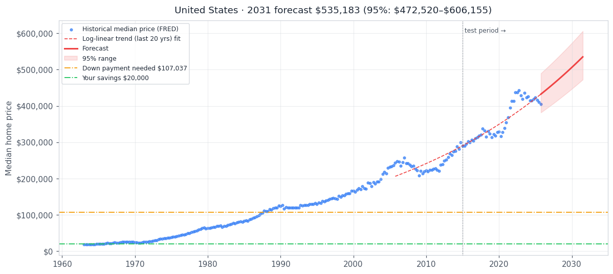

# PennyPath

A personal-finance app with two machine-learning models and a guarded AI chat assistant.
It tracks income, expenses, and debts, compares your spending with thrifty households
like yours, forecasts home prices for a down-payment plan, and plans debt payoff.

It ships with three front ends that share one Python core:

| Front end | Run | Notes |
|---|---|---|
| **Web app** (main) | `python run_web.py` → http://localhost:5000 | Flask JSON API + single-page UI |
| Desktop app | `python run_desktop.py` | Tkinter |
| Command line | `python run_cli.py` | Text menus |



---

## Features

- **Dashboard**: balances, monthly income, a needs/wants/savings bar, and a spending-by-category chart.
- **Expenses**: needs and wants by subcategory and frequency (weekly, biweekly, monthly, one-time), with edit and delete.
- **Budget AI** (ML): compares each category with what the thriftiest 25% of similar households spend.
- **Home Plan** (ML): forecasts regional median home prices with a 95% range, then works out the down payment, the monthly savings needed, and the mortgage payment.
- **Debt Plan**: simulates avalanche vs. snowball payoff month by month. It shows the debt-free date, total interest, payoff order, and a chart of the balance over time.
- **Affordability check**: standard loan payment formula against the 36% debt-to-income rule.
- **Finance chat**: a local LLM (Ollama + Gemma 3) that sees your real numbers. It refuses off-topic requests and falls back to an offline tip search when the model is unavailable.
- **Tips**: TF-IDF search over 200+ curated finance Q&As.
- **Account**: profile (age, household size, goal, risk tolerance), pay in any frequency, and password change.

## Quick start

```bash
pip install -r requirements.txt
python scripts/seed_demo.py  # optional: demo account  demo / demo1234
python run_web.py            # open http://localhost:5000
```

The first start trains the Budget AI (about 30 s). After that the models load from `models/`.

**Chat:** install [Ollama](https://ollama.com) and run `ollama pull gemma3:4b`. Without
Ollama, the chat still answers from the tip library in offline mode. To use a different
model, set the `PENNYPATH_MODEL` environment variable.

**Configuration (environment variables):**
- `PENNYPATH_DB`: path to the database file (default: `pennypath.db`).
- `SECRET_KEY`: session key. By default a random key is generated and saved to `.secret_key`, which git ignores.
- `PORT`: web server port (default: 5000).
- `FLASK_DEBUG=1`: turns on the debugger. Never use this on a network.

---

## The machine-learning models

Run `python scripts/train_models.py` to train both models and print their full evaluation.
Each ML page in the web app also has a model card with these numbers.

### 1. Budget AI: quantile regression on peer households

**Question:** for a household with my income, size, and age, what do *thrifty* households
spend on each category?

- **Data:** `scripts/generate_dataset.py` creates 3,000 **synthetic** households. Spending follows
  **Engel curves** (spend ∝ income^elasticity), a real consumer-economics pattern:
  - Necessities have elasticity < 1, so their share of income falls as income rises.
  - Luxuries have elasticity > 1, so their share rises.
  - Household size raises groceries, utilities and housing. Age raises healthcare costs.
  - A per-household "spending personality" scales discretionary spending.
- **Target:** the **25th percentile** of spending, the "thrifty peers" level. There are 20 targets:
  18 subcategories plus total needs and total wants. Subcategories are trained only on
  households that have that expense, because most households have no childcare, for example.
- **Features:** `log(income)`, household size, age.
- **Model selection:** each target compares a **linear quantile regression** (log-log, i.e. a
  classic Engel curve) with a **gradient-boosted quantile model**. Both are scored by pinball
  loss on a held-out 20% test split, and the better one is refit on all the data.
- **Baseline:** a fixed share of income, which is how the original version worked.

| Result (held-out test set) | |
|---|---|
| Targets beating the fixed-share baseline | **17 / 20** (the other 3 tie) |
| Total needs: pinball-loss improvement | **67%** |
| Median improvement across targets | **16%** |
| Coverage (share of households at or below the prediction; target 0.25) | **0.251** |
| Models chosen | 16 linear quantile, 4 gradient boosting |

**What the results show:** the gains come from necessities like rent, groceries and
utilities, where spending isn't proportional to income. Discretionary categories scale
roughly in proportion to income, so the fixed-share baseline is already near-optimal there,
and the model doesn't pretend otherwise.

### 2. Home price forecast: time-series model selection

- **Data:** FRED quarterly median sales price of houses sold, 1963–2025, for the US and
  four Census regions (`data/fredgraph.csv`).
- **Chronological split:** fit on 1963–2014, test on 2015–2025. The original version used a
  random split, which leaks future data into training and overstates accuracy.
- **Candidates:** linear trend on price, log-linear trend over all history (a constant
  growth rate), and log-linear trend over the last 20 years. A naive "price stays flat"
  forecast is the baseline.
- The model with the lowest test MAPE is refit on all data. The 95% range comes from its
  out-of-sample log error.

| Region | Chosen model test MAPE | Naive baseline | Fitted growth |
|---|---|---|---|
| United States | **4.7%** | 15.8% | 3.8%/yr |
| Northeast | **10.1%** | 26.8% | 4.8%/yr |
| Midwest | **8.6%** | 13.0% | 4.0%/yr |
| South | **5.3%** | 13.5% | 3.9%/yr |
| West | **5.6%** | 20.5% | 3.9%/yr |

The recent-20-year log-linear trend wins in every region. The all-history log-linear model
does worst (37–42% MAPE), because 1970s inflation inflates its growth rate. That shows why
the training window matters. A trend model can't foresee shocks like 2008 or 2021, so the
UI presents the forecast as a planning estimate with a range.

---

## Chat assistant guardrails

`pennypath/assistant/chat_guard.py` is shared by the web and desktop apps.

1. **Topic classifier:** a short, deterministic LLM call labels each message ALLOWED or BLOCKED.
   Off-topic requests (poems, code, trivia, jailbreaks) get a fixed refusal and never reach
   the answering model. It scored 30/30 on a mixed test set, plus 10/10 investing questions.
2. **Server-side system prompt:** the scope rules and the user's financial snapshot are
   built on the server from the database. The client can't supply or override them.
   - Only validated profile fields go into the prompt (age, household size, goal, risk tolerance).
   - Debt names are stripped to letters and numbers and quoted, so they can't inject instructions.
3. **History sanitizing:** only user and assistant turns are kept, each one length-limited,
   and only the last 10.
4. **Graceful degradation:** if Ollama isn't installed, isn't running, or crashes (for example
   a GPU error), the chat answers from the TF-IDF tip library. A keyword gate stops it from
   answering off-topic questions in that mode too.

## Security

- Passwords use salted **scrypt** hashes (Werkzeug). Accounts with the old SHA-256 hash
  still log in and are upgraded automatically.
- Login returns the same error for a wrong username or a wrong password, so attackers can't
  probe for usernames. New passwords must be 8+ characters.
- The session key comes from the environment or a git-ignored file. Session cookies are
  `HttpOnly` and `SameSite=Lax`. The debugger is opt-in only.
- Every API input is validated server-side, so bad numbers return a 400 error instead of
  crashing with a 500. Expense and debt queries are always scoped to the logged-in user.
- User text is escaped before it goes into the page HTML, so it can't run as script.
  Server errors never show stack traces to users.

## Tests

```bash
pip install -r requirements-dev.txt
python -m pytest
```

There are 56 tests, covering:
- **Calculations:** monthly conversion, the loan formula, and debt-payoff math checked
  against the standard amortization formula.
- **Auth:** salted hashes, and upgrading old-style hashes.
- **ML behavior:** the models follow the Engel-curve shape, beat their baselines, are
  calibrated, and use a chronological split.
- **API:** validation, keeping users' data separate, and server-built chat prompts.
- **Chat guardrails:** run with a fake Ollama that can be made to crash.

Tests use a temporary database and never touch `pennypath.db`.

## Project structure

```
run_web.py · run_desktop.py · run_cli.py    Start each app (run from this folder)

pennypath/                   All application code
├── paths.py                 Where data, models, and the database live
├── database.py              SQLite persistence (one connection per thread)
├── auth.py                  Password hashing, login/registration
├── prompts.py               Validated console input for the CLI
├── finance/
│   ├── expenses.py          Needs/Wants model, frequency → monthly conversion
│   ├── accounts.py          Savings / checking / wage account balances
│   ├── wages.py             Weekly wage
│   ├── affordability.py     Loan payment formula + 36% rule
│   └── debt_planner.py      Avalanche / snowball simulation
├── ml/
│   ├── budget.py            Budget AI: quantile regression, model selection, report
│   └── home_savings_plan.py Home price forecasting + savings plan + chart
├── assistant/
│   ├── chat_guard.py        Chat topic filter, prompt building, offline fallback
│   └── tips.py              TF-IDF search over data/financial_tips.json
└── ui/
    ├── web.py               Flask JSON API (+ templates/index.html single-page UI)
    ├── desktop.py           Tkinter app
    └── cli.py               Command-line app

data/                        fredgraph.csv, financial_tips.json, synthetic household CSVs
scripts/
├── generate_dataset.py      Synthetic household data (Engel curves)
├── train_models.py          Train + evaluate both models → models/metrics.json
└── seed_demo.py             Demo account with realistic data
tests/                       pytest suite
docs/                        Images for this README
models/                      Trained models (generated, git-ignored)
```

## Limitations and next steps

- The Budget AI is trained on **synthetic** data. Swapping in real household survey
  microdata (e.g. the BLS Consumer Expenditure Survey PUMD) is the natural next step, and
  the pipeline doesn't depend on where the data comes from.
- Expenses have no dates yet, so there are no month-over-month trends.
- SQLite fits a single-machine app. A multi-user deployment would use PostgreSQL behind a
  production WSGI server (e.g. gunicorn), with rate limiting on login.
- Chat feedback (👍/👎) is stored in the desktop app but not yet used to improve answers.
